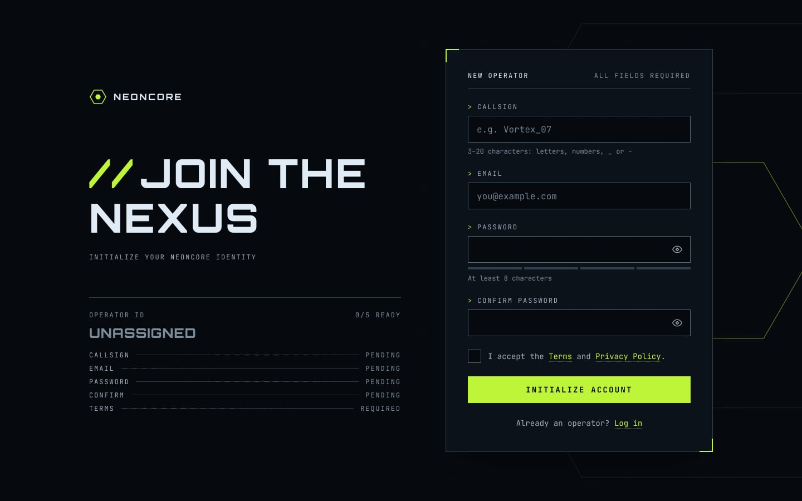

# Frontend Mentor - Gamer sign-up form solution

This is a solution to the [Gamer sign-up form challenge on Frontend Mentor](https://www.frontendmentor.io/challenges/gamer-sign-up-form). Frontend Mentor challenges help you improve your coding skills by building realistic projects.

## Table of contents

- [Overview](#overview)
  - [The challenge](#the-challenge)
  - [Screenshot](#screenshot)
  - [Links](#links)
- [My process](#my-process)
  - [Built with](#built-with)
  - [What I learned](#what-i-learned)
  - [Continued development](#continued-development)
  - [Useful resources](#useful-resources)
- [Author](#author)
- [Acknowledgments](#acknowledgments)

## Overview

### The challenge

Users should be able to:

- Fill in the form with a callsign, email, password, and password confirmation, and accept the terms
- Receive form validation messages if any field is missed or filled in incorrectly
- Show and hide each password with the eye button
- See a password strength meter update as they type
- See a loading state on the button while the form submits, then a success message
- Complete the form only using their keyboard
- Have inputs, hints, error messages, and the success message announced on their screen reader
- View the optimal layout for the interface depending on their device's screen size
- See hover and focus states for all interactive elements on the page

Optional extras included:

- Live **Operator ID** readout that mirrors form validity (pending, OK, fault codes, locked)
- Panel shake on invalid submit (respects `prefers-reduced-motion`)
- Success view with focused heading after a short `Transmitting_` state

### Screenshot



### Links

- Solution URL: [https://github.com/sergiofisio/challenge-gamer-sign-up-form](https://github.com/sergiofisio/challenge-gamer-sign-up-form)
- Live Site URL: [https://sergiofisio.github.io/challenge-gamer-sign-up-form/](https://sergiofisio.github.io/challenge-gamer-sign-up-form/)

## My process

### Built with

- Semantic HTML5 markup
- CSS custom properties / design tokens
- Flexbox and CSS Grid
- Mobile-first responsive layout
- [Next.js](https://nextjs.org/) (App Router) + TypeScript
- [Tailwind CSS](https://tailwindcss.com/) v4
- [Motion](https://motion.dev/) for light UI animation
- Accessibility-focused form patterns (`aria-describedby`, live regions, keyboard focus management)
- Static export + GitHub Actions → GitHub Pages

### What I learned

- Progressive field validation: check on blur when a field has content, then re-validate on every keystroke once touched; empty-field errors mainly appear on submit
- Password strength scoring as advisory UI (Weak → Strong) separate from the single hard rule of 8+ characters
- Building a double focus ring and loading/outline button states that match a dense cyberpunk UI kit
- Shipping a Next.js app to GitHub Pages with `output: "export"`, `basePath`, and a Pages workflow

### Continued development

- Closer pixel polish against tablet breakpoints if Figma access is available
- Caps Lock warning on password fields
- Shared field/button primitives reused in a matching log-in screen

### Useful resources

- [Frontend Mentor challenge brief](https://www.frontendmentor.io/challenges/gamer-sign-up-form) — requirements and state behavior
- [Next.js static exports](https://nextjs.org/docs/app/guides/static-exports) — GitHub Pages-friendly build
- [MDN: ARIA live regions](https://developer.mozilla.org/en-US/docs/Web/Accessibility/ARIA/Guides/Live_regions) — announcing submit validation summary

## Getting started

```bash
yarn install
yarn dev
```

Open [http://localhost:3000](http://localhost:3000).

```bash
yarn build   # static export to /out (set GITHUB_PAGES=true for Pages basePath)
yarn lint
```

## Author

- GitHub - [@sergiofisio](https://github.com/sergiofisio)

## Acknowledgments

Challenge design and assets by [Frontend Mentor](https://www.frontendmentor.io).
